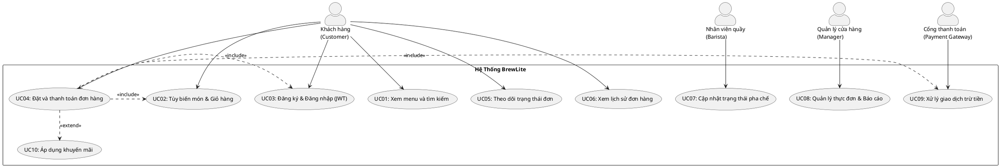

# Tài Liệu Đặc Tả Yêu Cầu Phần Mềm Rút Gọn (Software Requirements Specification - SRS)

## 1. Yêu cầu chức năng (Functional Requirements - FR)

| Mã YC | Tên yêu cầu chức năng | Phân loại | MoSCoW | Tiêu chí chấp nhận (Acceptance Criteria) |
| :---: | :--- | :--- | :---: | :--- |
| **FR-01** | Xem danh mục và danh sách sản phẩm | Menu | **Must** | **Given** người dùng mở ứng dụng, **When** trang chủ tải xong, **Then** danh sách sản phẩm được nhóm theo danh mục, hiển thị đầy đủ tên, ảnh thumbnail, giá bán và nhãn "Còn hàng/Hết hàng". |
| **FR-02** | Xem chi tiết sản phẩm và tùy biến | Sản phẩm | **Must** | **Given** người dùng bấm vào một sản phẩm, **When** modal/trang chi tiết mở ra, **Then** người dùng có thể chọn Size (S/M/L), độ ngọt (100%, 70%, 50%, 0%), đá (100%, 50%, 0%) và chọn nhiều topping. Giá tiền cập nhật tức thì theo tùy chọn. |
| **FR-03** | Quản lý giỏ hàng (Cart) | Giỏ hàng | **Must** | **Given** người dùng chọn xong món, **When** bấm "Thêm vào giỏ", **Then** món và các tùy chọn được lưu vào giỏ hàng. Người dùng có thể tăng/giảm số lượng hoặc xóa món; tổng giá trị đơn được tính toán tự động. |
| **FR-04** | Đăng ký & Đăng nhập (Auth) | Xác thực | **Must** | **Given** người dùng chưa đăng nhập, **When** cung cấp email và mật khẩu hợp lệ (tối thiểu 6 ký tự), **Then** hệ thống xác thực, trả về JWT access token và thông tin phiên làm việc. |
| **FR-05** | Tạo đơn hàng (Order Creation) | Đặt hàng | **Must** | **Given** giỏ hàng có sản phẩm và người dùng đã xác thực, **When** bấm "Tiến hành đặt hàng", **Then** hệ thống tạo bản ghi đơn hàng với trạng thái `PENDING`, kiểm tra tồn kho và sinh mã đơn duy nhất. |
| **FR-06** | Xử lý thanh toán mô phỏng (Payment) | Thanh toán | **Must** | **Given** đơn hàng ở trạng thái `PENDING`, **When** người dùng chọn phương thức (Thẻ/Ví) kèm `Idempotency-Key` và bấm thanh toán, **Then** hệ thống xử lý giao dịch. Nếu thành công, chuyển trạng thái đơn sang `PAID`, trừ tồn kho. Nếu trùng key, trả về kết quả cũ mà không trừ tiền lần hai. |
| **FR-07** | Theo dõi trạng thái đơn hàng (Tracking) | Trạng thái | **Must** | **Given** đơn hàng đã được thanh toán, **When** người dùng mở trang theo dõi đơn, **Then** hiển thị timeline trạng thái (`PENDING` -> `PAID` -> `PREPARING` -> `COMPLETED`) và thông tin món đã đặt. |
| **FR-08** | Xem lịch sử đơn hàng cá nhân | Lịch sử | **Should** | **Given** người dùng đã đăng nhập, **When** vào mục "Đơn hàng của tôi", **Then** danh sách các đơn đã đặt được liệt kê theo thứ tự thời gian giảm dần với trạng thái rõ ràng. |
| **FR-09** | Áp dụng mã khuyến mãi (Promotion) | Khuyến mãi | **Could** | **Given** người dùng nhập mã voucher hợp lệ tại giỏ hàng, **When** hệ thống xác thực điều kiện áp dụng, **Then** giảm trực tiếp số tiền chiết khấu vào tổng thanh toán. |
| **FR-10** | Tích điểm thành viên (Loyalty) | Khách hàng thân thiết | **Won't** (MVP) | Hệ thống tích lũy điểm thưởng tương ứng 5% giá trị đơn hàng sau khi hoàn tất. *(Bảo lưu triển khai ở giai đoạn mở rộng)* |

---

## 2. Yêu cầu phi chức năng (Non-Functional Requirements - NFR)

| Mã YC | Thuộc tính chất lượng | Mô tả chi tiết | Tiêu chí chấp nhận & Kiểm chứng | MoSCoW |
| :---: | :--- | :--- | :--- | :---: |
| **NFR-01** | **Hiệu năng (Performance)** | Thời gian phản hồi API và tốc độ tải trang giao diện. | 95% các API truy vấn (GET /products) phản hồi trong thời gian $\le 300\text{ ms}$; thời gian First Contentful Paint (FCP) trên di động $\le 1.8\text{ s}$. | **Must** |
| **NFR-02** | **Bảo mật (Security)** | Bảo vệ dữ liệu nhạy cảm, mã hóa và kiểm soát phiên làm việc. | Mật khẩu băm bằng Bcrypt với salt rounds $\ge 10$; giao tiếp 100% qua HTTPS; API bảo vệ bằng JWT; lọc dữ liệu đầu vào qua DTO Validator để ngăn chặn SQL Injection / XSS. | **Must** |
| **NFR-03** | **Tính khả dụng (Usability & PWA)** | Thiết kế chuẩn Mobile-first, thân thiện trên màn hình cảm ứng di động. | Đạt chuẩn PWA (manifest.json, icon, theme-color), điểm Lighthouse Accessibility $\ge 90$, hỗ trợ thao tác chạm ngón tay tiện lợi. | **Must** |
| **NFR-04** | **Tính sẵn sàng & Độ tin cậy (Reliability)** | Hệ thống xử lý lỗi êm đềm, không làm treo ứng dụng client. | Uptime dịch vụ API $\ge 99\%$; tích hợp Health Check endpoint (`GET /health`) phục vụ tự động giám sát; có fallback UI khi mạng gián đoạn. | **Must** |
| **NFR-05** | **Khả năng triển khai (Deployability)** | Quy trình đóng gói và triển khai tự động hóa. | Ứng dụng đóng gói trong Docker Container độc lập; triển khai tự động qua CI/CD GitHub Actions khi merge code vào nhánh chính; hỗ trợ rollback khi lỗi. | **Must** |
| **NFR-06** | **Tính bất biến giao dịch (Idempotency)** | Chống trùng lặp giao dịch thanh toán do mạng trễ hoặc bấm đúp. | Mỗi request thanh toán mang `Idempotency-Key` (UUIDv4); Backend từ chối hoặc trả kết quả đã lưu nếu request gửi lại trong 60 giây. | **Must** |

---

## 3. Sơ đồ Use-Case tổng quát toàn hệ thống (System Use-Case Overview)

