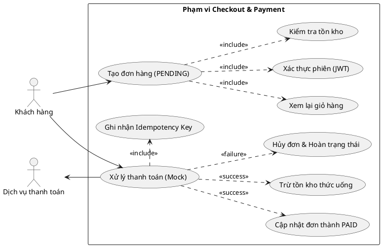

# Đặc Tả Use-Case Trọng Tâm: Đặt và Thanh Toán Đơn Hàng (UC04)

## 1. Thông tin chung (General Information)
- **Mã Use-Case:** UC-CHECKOUT-01 (hay UC04)
- **Tên Use-Case:** Đặt và thanh toán đơn hàng (Order Placement & Mock Payment Processing)
- **Actor chính:** Khách hàng (Customer)
- **Actor hỗ trợ:** Dịch vụ thanh toán (Mock Payment Service), Hệ quản trị CSDL (PostgreSQL)
- **Trigger:** Khách hàng nhấn nút "Tiến hành thanh toán" trên màn hình giỏ hàng (Cart Drawer/Page).
- **Mã yêu cầu liên quan:** FR-03 (Giỏ hàng), FR-04 (Xác thực JWT), FR-05 (Tạo đơn hàng), FR-06 (Xử lý thanh toán), NFR-02 (Bảo mật), NFR-06 (Idempotency).

---

## 2. Sơ đồ Use-Case Diagram phạm vi chi tiết

---

## 3. Tiền điều kiện & Hậu điều kiện (Preconditions & Postconditions)

### 3.1. Tiền điều kiện (Preconditions)
1. Giỏ hàng của khách hàng có ít nhất một món hợp lệ với số lượng $\ge 1$.
2. Khách hàng đã đăng nhập vào hệ thống và sở hữu JWT Token hợp lệ.
3. Ứng dụng client đã sinh sẵn mã `idempotencyKey` (chuẩn UUID v4).

### 3.2. Hậu điều kiện (Postconditions)
- **Nếu thành công:**
  1. Bản ghi `Order` được tạo với trạng thái `PAID`.
  2. Số lượng nguyên liệu/tồn kho được trừ tương ứng bên trong Database Transaction.
  3. Bản ghi `Payment` được lưu với trạng thái `COMPLETED` cùng transaction code duy nhất.
  4. Giỏ hàng client được làm rỗng và điều hướng khách sang trang theo dõi đơn hàng (`/orders/:id/track`).
- **Nếu thất bại:**
  1. Trạng thái đơn chuyển sang `CANCELLED` hoặc giữ `PENDING` cho phép thử lại.
  2. Không có bất kỳ giao dịch tiền tệ nào bị trừ. Tồn kho không thay đổi.
  3. Hiển thị thông báo lỗi cụ thể cho người dùng.

---

## 4. Các luồng thực thi (Execution Flows)

### 4.1. Luồng chính (Main Flow - Happy Path)
1. Khách hàng xem lại giỏ hàng, chọn phương thức thanh toán (Ví MoMo / Thẻ ATM) và nhấn "Xác nhận đặt hàng & Thanh toán".
2. Client gửi yêu cầu tạo đơn: `POST /orders` kèm Bearer Token (JWT).
3. Backend NestJS xác thực JWT hợp lệ.
4. Backend mở PostgreSQL Database Transaction:
   - Kiểm tra tồn kho của tất cả sản phẩm trong giỏ hàng.
   - Tính toán lại tổng tiền từ server để phòng chống can thiệp giá từ client.
   - Tạo đơn hàng mới với mã tham chiếu (ví dụ: `BWL-89421`) và trạng thái `PENDING`.
   - Commit transaction và trả về `orderId` cùng tổng tiền.
5. Client gửi yêu cầu thanh toán: `POST /payments/process` kèm Header `Idempotency-Key` và payload `{ orderId, paymentMethod: 'MOMO', amount }`.
6. Payment Service kiểm tra `Idempotency-Key`: chưa tồn tại giao dịch xử lý trước đó.
7. Payment Service gửi yêu cầu trừ tiền mô phỏng (Mock Gateway Simulation) và nhận kết quả thành công.
8. Backend cập nhật trạng thái bản ghi Payment thành `COMPLETED`, cập nhật Order thành `PAID`, và trừ tồn kho các món đã đặt.
9. Backend lưu `Idempotency-Key` cùng kết quả phản hồi vào cache/database.
10. Hệ thống trả về `status: 200 OK` kèm chi tiết hóa đơn.
11. Giao diện Next.js xóa sạch giỏ hàng và điều hướng người dùng tới màn hình theo dõi trạng thái đơn hàng.

### 4.2. Luồng thay thế (Alternative Flows)
- **A1: Khách hàng gửi lại yêu cầu thanh toán do mạng chập chờn (Idempotency Trigger):**
  - Tại bước 5, nếu client retry và gửi lại cùng `Idempotency-Key`.
  - Backend phát hiện key đã có giao dịch thành công trước đó.
  - Backend bỏ qua khâu trừ tiền lần 2, lập tức trả về kết quả thành công của giao dịch trước. Khách hàng không bị trừ tiền lặp lại.
- **A2: Người dùng áp dụng mã giảm giá hợp lệ:**
  - Tại bước 1, khách hàng nhập mã coupon. Hệ thống tính chiết khấu hợp lệ, tổng tiền cập nhật trước khi tạo đơn.

### 4.3. Luồng ngoại lệ (Exception Flows)
- **E1: Sản phẩm đã hết hàng trong quá trình thanh toán (Out of Stock):**
  - Tại bước 4, kiểm tra tồn kho phát hiện một sản phẩm có số lượng khả dụng $= 0$.
  - Backend rollback transaction, trả về lỗi `HTTP 409 Conflict: Sản phẩm đã hết hàng`.
  - Client hiển thị cảnh báo đỏ trên giỏ hàng và đề xuất khách hàng đổi món khác.
- **E2: Phiên đăng nhập hết hạn (Invalid/Expired JWT):**
  - Tại bước 3, JWT Guard phát hiện token không hợp lệ hoặc đã quá hạn.
  - Backend trả về `HTTP 401 Unauthorized`.
  - Client lưu lại trạng thái giỏ hàng vào LocalStorage và hiển thị modal đăng nhập lại mà không làm mất món.
- **E3: Cổng thanh toán từ chối hoặc tài khoản không đủ số dư:**
  - Tại bước 7, Mock Payment Service trả về kết quả giao dịch thất bại (`PAYMENT_FAILED`).
  - Backend ghi nhận giao dịch `Payment` là `FAILED`, cập nhật trạng thái `Order` là `CANCELLED`.
  - Client hiển thị thông báo: "Giao dịch không thành công. Vui lòng kiểm tra lại tài khoản hoặc chọn phương thức khác."

---

## 5. Tiêu chí nghiệm thu (Acceptance Criteria for Testing)
1. **Kiểm thử Unit Test:** Logic kiểm tra tồn kho và tính toán giá trị giỏ hàng phải đúng tuyệt đối với sai số $= 0$.
2. **Kiểm thử Tích hợp (Integration Test):** Gọi API `POST /payments/process` hai lần liên tiếp với cùng một `Idempotency-Key` chỉ sinh ra duy nhất một bản ghi Payment thành công và không cập nhật đơn hàng hai lần.
3. **Kiểm thử E2E:** Chuỗi thao tác từ Menu -> Thêm món -> Giỏ hàng -> Đặt đơn -> Nhận trạng thái `PAID` hoàn tất trong thời gian $\le 3\text{ giây}$.
